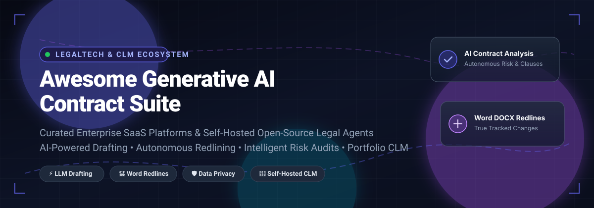
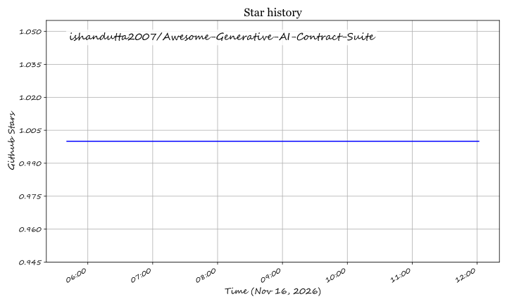

# Awesome Generative AI Contract Suite ⚖️🤖

  

  
  
  
  
  
  

## 🌟 Top Generative AI Contract Suite Ecosystem

**Curated List of Enterprise SaaS Platforms & Open-Source GitHub Projects**  
*Focused on AI-Powered Contract Drafting, Redlining, Review & Self-Hosted Legal Reasoning*  
**Last updated: March 2026**

This repository tracks notable **enterprise SaaS platforms** and **open-source projects** for **Generative AI Contract Suites**, **LegalTech Copilots**, and **Contract Lifecycle Management (CLM)** systems. These tools empower legal, procurement, and commercial teams to draft, review, negotiate, redline, and analyze agreements with precision using large language models (LLMs)—spanning enterprise copilots grounded in millions of portfolio documents to privacy-first, self-hosted autonomous legal agents running on your local hardware.

✨ **Category leaders include** Icertis Vera AI, Ironclad AI, Harvey AI, Luminance, Spellbook, Robin AI, and prominent open-source powerhouses like Mike OSS Legal AI, ai-legal-claude, claude-legal-skill, draftLegal, and Hermes Legal Advisor.

🔒 **Open-Source & Self-Hosted Emphasis**: This collection spotlights active projects for self-hosted contract AI, local LLM inference via Ollama, open-source redlining in Microsoft Word (`.docx`), and community-driven contract compliance—crucial for organizations prioritizing strict data sovereignty, GDPR/HIPAA compliance, and avoiding six-figure annual enterprise licensing fees.

---

## 📑 Table of Contents
- [📊 Sector Overview & Market Dynamics](#-sector-overview--market-dynamics)
- [🏢 SaaS / Hosted Platforms](#-saashosted-platforms)
- [💻 Open-Source GitHub Projects](#-open-source-github-projects)
- [🤝 How to Contribute](#-how-to-contribute)
- [💖 Support](#-support)
- [📈 Star History](#-star-history)
- [⚠️ Disclaimer](#️-disclaimer)

---

## 📊 Sector Overview & Market Dynamics

The global Contract Lifecycle Management (CLM) and Legal Generative AI software market is estimated at **$3.5B to $4.0B in 2026** and projected to exceed **$10B+ by the early 2030s** at a compound annual growth rate (CAGR) of 13–15% (with specialized legal GenAI expanding at 25%+). 

Rather than a winner-take-all monopoly, the sector exhibits a **bifurcated, moderately fragmented ecosystem**:
- **Platform Suites & Workflow Incumbents**: Consolidators like Icertis, DocuSign (Lexion), and Thomson Reuters (Casetext CoCounsel) command enterprise-wide repository budgets, deep ERP/CRM hooks, and administrative governance.
- **AI-Native Innovators & Open-Source Agents**: Rapidly emerging AI agents and specialized copilot startups (Harvey, Spellbook, Robin AI, and open-source models like Mike and draftLegal) drive aggressive product velocity in multi-turn clause redlining, contract due diligence, and offline data privacy.

---

## 🏢 SaaS / Hosted Platforms

*Ranked descending by Company Valuation / Revenue scale.*

| Product | Company Size (Valuation / Revenue) | Description | Pricing (Starting) | Free Tier / Trial Limits |
|:---|:---|:---|:---|:---|
| **[Harvey AI](https://www.harvey.ai/)** | 🦄 $15.5B valuation (~$400M ARR) | **The enterprise legal AI benchmark.** Agents execute complex legal workflows end-to-end—contract analysis, due diligence, drafting, research—splitting tasks across parallel agents and returning cited, review-ready output. Over 200,000 professionals across 3,500+ firms and corporate legal teams. | ~$1,200/seat/month (mandatory annual commitment; typically 20–25 seat minimum starting at ~$288,000/year) | No free tier or self-serve trial (evaluation strictly via sales-led demo and enterprise scoping) |
| **[Icertis Vera AI Suite](https://www.icertis.com/)** | 🦄 $5.0B valuation (~$300M+ ARR) | **Enterprise contract AI trained on millions of agreements.** Vera powers agents that draft, redline, negotiate, and analyze portfolios within boundaries you set. Copilot turns 100–150 page agreements into executive summaries so reviewers focus on material issues. Rated leading CLM vendor by MGI Research. | Starts at ~$88,000/year base deployment (total first-year ACV typically $100,000–$300,000+ including AI modules and onboarding) | No free tier or public trial (gated behind enterprise procurement discovery and sales consultation) |
| **[Ironclad AI](https://ironcladapp.com/)** | 🦄 $3.2B valuation (~$200M+ ARR) | Enterprise CLM platform with AI-assisted review and drafting. Positioned for teams wanting execution (approvals, workflows, signatures) alongside AI assistance, workflow automation, and custom playbooks. | Starts at ~$50,000/year (mid-market deployments typically scale from $50,000 to $120,000+/year plus $10,000–$75,000 implementation) | No free tier or self-serve trial (requires booking a sales-guided product demo) |
| **[ContractPodAi Leah](https://contractpodai.com/)** | 💼 ~$700M valuation (~$50M ARR) | AI-powered legal platform covering contract management, review/analysis, and legal project management. Role-based access with annual access reviews. | Starts at ~$50,000/year (Standard Tier; mid-market and enterprise rollouts range from $80,000 to $250,000+/year) | No free tier or public trial (evaluation requires direct enterprise demo request) |
| **[Casetext CoCounsel](https://casetext.com/)** | 💼 $650M acquisition by Thomson Reuters | AI legal assistant integrated into the Thomson Reuters legal ecosystem with comprehensive contract analysis, clause evaluation, and legal research. | Starts at $340/month billed annually (~$4,080/year per user for CoCounsel Essentials; integrated Westlaw Precision bundles scale upwards of $1,600/month) | No free tier or public trial (access requires requesting a demo or pilot via Thomson Reuters sales) |
| **[Spellbook](https://www.spellbook.legal/)** | 🚀 $350M valuation (~$100M ARR target) | AI contract drafting and review assistant built natively into Microsoft Word using GPT-4 and Claude models. Suggests redlines, clauses, and risk analyses directly inside documents. | Starts at $360/month billed annually (~$4,320/year per seat; individual intro plans start at $99–$250/month) | 7-day free trial (full Word add-in drafting and review access without upfront auto-charge) |
| **[Evisort AI](https://www.evisort.com/)** | 💼 ~$300M acquisition by Workday (~$32M ARR) | Contract intelligence with 120+ pre-built AI models for clause identification, risk flagging, and term extraction. Acquired by Workday to power enterprise document intelligence. | Starts at ~$30,000/year (baseline deployments range $30,000–$60,000/year; larger rollouts reach $100,000+) | No free tier or public trial (sales-led evaluation and custom demo required) |
| **[Robin AI](https://www.robinai.com/)** | 🚀 ~$200M valuation (~$20M ARR) | AI legal assistant with contract review capabilities. Uses Anthropic Claude models with legal-specific fine-tuning. Positioned for in-house legal teams. | $0/month free tier; Pro/Enterprise tiers start at ~$5,000–$15,000+/year custom quote | Free-for-ever plan available (single user capped at 10 AI messages/day); custom pilots via sales for Pro/Enterprise |
| **[Lexion AI](https://www.lexion.ai/)** | 💼 $165M acquisition by DocuSign | AI contract management acquired by DocuSign to power Intelligent Agreement Management (IAM), obligation tracking, and spend visibility. | Starts at ~$15,000/year (typical contracts range from $15,000 to $150,000/year based on document volume and seats) | No free tier or self-serve sandbox for Lexion IAM (requires requesting a guided demo through DocuSign sales) |
| **[Luminance](https://www.luminance.com/)** | 🚀 $100M+ valuation (~$40M ARR) | Legal-Grade AI with conversational assistant Lumi. Analyzes up to 20 documents in one conversation, compares drafts to precedents, checks clauses against verified external legal sources, and generates reports. | Starts at ~$43,000/year (typical baseline deployments range $43,000–$60,000+/year, usually on multi-year commitments) | No free tier or public trial (demo and structured enterprise proof-of-concept pilot via sales) |

---

## 💻 Open-Source GitHub Projects

*Ranked descending by GitHub Stargazer Count.*

| Project | Stars_Badge | Description |
|:---|:---|:---|
| **[Mike (Open Legal Products)](https://github.com/open-legal-products/mike)** |  | **The leading open-source legal AI platform.** Provides a full-stack legal intelligence workspace for document review, contract clause analysis, and automated workflows designed to run privately on organization hardware. |
| **[ai-legal-claude](https://github.com/zubair-trabzada/ai-legal-claude)** |  | **Comprehensive AI Legal Assistant skill for Claude Code.** Features 14 skills and 5 parallel agents covering contract review, risk scoring, NDA generation, compliance auditing, negotiation strategy, and executive PDF reporting. |
| **[claude-legal-skill](https://github.com/evolsb/claude-legal-skill)** |  | **AI-powered contract review skill with CUAD dataset risk detection.** Leverages market benchmarks and produces lawyer-ready redlines. Directly compatible with Claude Code, Codex, Cursor, and 26+ developer CLI tools. |
| **[contract-review-pro](https://github.com/CSlawyer1985/contract-review-pro)** |  | **Professional contract audit agent skill built on legal audit methodologies.** Tailored for civil and commercial legal frameworks with structured clause risk evaluation. |
| **[Prism-Legal-OS](https://github.com/FuturixAI-and-Quantum-Works/Prism-Legal-OS)** |  | **Open-source legal operating system for contract analysis, legal research, and litigation.** Offers modular pipeline components to process unstructured legal agreements and extract risk parameters. |
| **[Paparusi legal-ai-agent](https://github.com/Paparusi/legal-ai-agent)** |  | **Localized open-source contract review agent built for Vietnamese law.** Analyzes 10 key risk categories (excessive penalties >8%, auto-renewal traps, unilateral termination) and checks statutory compliance against Civil, Commercial, and Labor codes with exact article citations. |
| **[contract-review](https://github.com/xiaodingfeng/contract-review)** |  | **Web application for smart contract review.** Features contract upload, AI pre-analysis, custom review point configuration, OnlyOffice online preview and editing, and knowledge base retrieval. |
| **[doc-haus](https://github.com/sure-scale/doc-haus)** |  | **The open-source legal AI agent for local disk operations.** Keeps confidential documents on your local filesystem while outputting redlines directly into Microsoft Word documents as native tracked changes. |
| **[Vaquill MS Word Add-in](https://github.com/Vaquill-AI/ms-word-addin)** |  | **Open-source legal AI assistant for Microsoft Word.** Provides task-pane contract review, corporate playbooks, clause drafting, and legal research directly inside Microsoft Word desktop and web versions. |
| **[legal-redline-tools](https://github.com/evolsb/legal-redline-tools)** |  | **Generates tracked-changes Word docs (`.docx`) and redline PDFs from AI reviews.** Generates the exact deliverables lawyers and counsel exchange during active commercial negotiations. |
| **[Hermes Legal Advisor](https://github.com/Lethe044/hermes-legal)** |  | **Feature-complete CLI for contract analysis with inline Word redlines.** Offline scanner requires zero API keys. Supports Groq, Gemini, OpenRouter, and Ollama. Generates real Word Tracked Changes, batch reports, and visual HTML dashboards. |
| **[draftLegal](https://github.com/AniketTati/draft-legal)** |  | **Self-hosted contract suite positioned as an open-source Ironclad + Harvey.** Deploys via `docker compose up` so contracts never touch third-party SaaS. Features ~30 agent tools, pgvector + Elasticsearch hybrid portfolio retrieval, and full lifecycle approval/signing flows. |

---

## 🤝 How to Contribute

Contributions are warmly welcome! Help make this ecosystem more complete:

1. 🍴 Fork the repository.
2. 🌿 Create a descriptive branch: `git checkout -b feature/add-new-legal-tool`.
3. 📝 Add or edit entries in `README.md` following the existing tabular format and guidelines.
4. 🔗 Include: Product/Project Name, Official Link, Company Size / Stars_Count, Pricing / Free tier details, and factual descriptions.
5. 🚀 Submit a Pull Request with a clear explanation of the addition.

---

## 💖 Support

If you find this curated legal AI contract suite valuable:
- ⭐ **Star** this repository on GitHub to help others discover it!
- 🍴 **Fork** and share it with your legal engineering and legal tech communities.
- ☕ If you appreciate the curation and ongoing maintenance, consider sponsoring or buying a coffee:  
  👉 **[Sponsor on GitHub](https://github.com/sponsors/ishandutta2007)**

---

## 📈 Star History

---

## ⚠️ Disclaimer

- This repository is a **community-curated informational guide** and does not constitute formal legal advice or commercial endorsements.
- Contract AI suites process legally privileged, proprietary, and highly sensitive agreements. **Data sovereignty and security standards (GDPR, SOC2, HIPAA) are critical.** Self-hosted open-source solutions allow documents to remain entirely behind your firewalls, whereas cloud SaaS platforms require sending data to third-party endpoints.
- **Enterprise legal AI software pricing represents substantial capital commitments.** Solutions like Harvey and Icertis frequently require six-figure minimum annual contracts. Tools like Spellbook and CoCounsel offer lower-commitment entry points (~$340–$360/month). Open-source suites like **Mike**, **draftLegal**, and **Hermes Legal Advisor** offer mature, zero-software-license alternatives that can be customized to enterprise workflows. Always engage qualified legal counsel before signing agreements generated or reviewed by AI.

---

  Made with ❤️ for legal engineers, contract researchers, corporate legal teams, and organizations pioneering autonomous legal infrastructure.

## ⭐ Star History

<a href="https://star-history.com/#ishandutta2007/Awesome-Generative-AI-Contract-Suite&Timeline" align="center">
  <picture>
    <source media="(prefers-color-scheme: dark)" srcset="assets/ishandutta2007_Awesome-Generative-AI-Contract-Suite_growth.svg">
    
  </picture>
</a>
